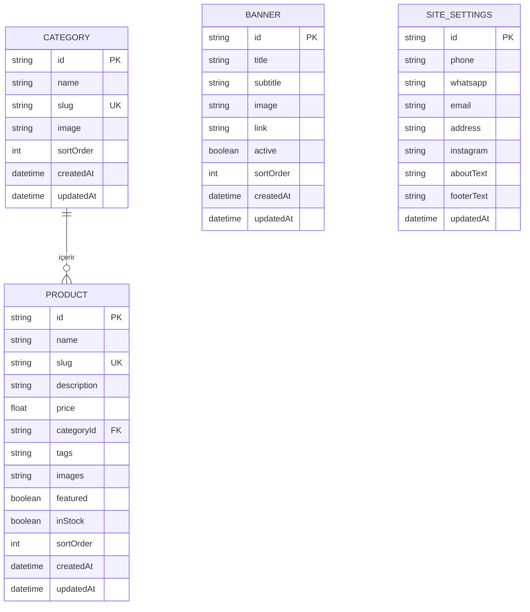

# 🌸 Lotus Çiçekçilik — Butik Florist & Custom CMS

<p align="center">
  
</p>

<p align="center">
  <strong>İstanbul Kadıköy merkezli butik çiçek atölyesi için modern, editorial e-ticaret vitrini ve hafif Custom CMS yönetim paneli.</strong>
</p>

<p align="center">
  
  
  
  
  
  
</p>

---

## 📖 Proje Hakkında

**Lotus Çiçekçilik**, 2015 yılından bu yana hizmet veren bir çiçekçi için tasarlanmış; zarif tipografisi (*Playfair Display* & *Inter*), hızlı performansı ve kullanımı kolay **özel CMS (Admin Paneli)** ile donatılmış modern bir web platformudur.

Harici ağır e-ticaret platformlarına ihtiyaç duymadan, yerel **SQLite veritabanı** (`dev.db`) üzerinden çalışan, sıfır karmaşıklıkla kurulan ve doğrudan WhatsApp API entegrasyonuyla sipariş toplayan hibrit bir çözümdür.

---

## ✨ Öne Çıkan Özellikler

### 🛍️ Mağaza & Vitrin (Storefront)
- **Dinamik Hero Slider:** Yönetim panelinden yönetilebilen, otomatik dönen ve özel CTA butonlarına sahip görsel slider.
- **Güven & Hizmet Rozetleri:** Aynı gün 2 saatte kurye teslimatı, taze çiçek garantisi ve ücretsiz el yazısı not kartı gibi değer önerileri.
- **Kategori Vitrini:** Buketler, Aranjmanlar, Kutuda Çiçekler, Düğün & Nişan, Cenaze Çiçekleri ve Saksı Çiçekleri.
- **Zengin Ürün Kartları:** Hover efektleri, teslimat ipucu, stok rozetleri ve "Özel Seçim" vurguları.
- **Doğrudan WhatsApp Sipariş Akışı:** Ürün adı ve bağlantısını otomatik mesaja dönüştüren WhatsApp Sipariş butonu.
- **Fotoğraflı Atölye Hikayesi:** Kadıköy atölyesinden gerçek kareler ve zanaat istatistikleri.
- **Müşteri Değerlendirmeleri (Social Proof):** 5 yıldızlı müşteri geri bildirimleri ve deneyimleri.
- **Instagram Mini Vitrini:** Sosyal medya takipçileri için şık galeri önizlemesi.

### ⚙️ Entegre Custom CMS (Yönetim Paneli - `/admin`)
- **Şifre Korumalı Giriş:** `.env` üzerinden özelleştirilebilir şifreli oturum yönetimi (`ADMIN_PASSWORD`).
- **Ürün Yönetimi:** Yeni ürün ekleme, fiyat/stok güncelleme, çoklu fotoğraf, etiketler ve kategori ilişkilendirme.
- **Kategori Yönetimi:** Yeni kategoriler açma, görsel atama ve sıralama düzenleme.
- **Hero Banner Yönetimi:** Ana sayfadaki kayan bannerları dinamik olarak düzenleme, bağlantı ve başlık belirleme.
- **Site & İletişim Ayarları:** Telefon, WhatsApp, adres, Instagram hesabı ve footer metinlerini kod değiştirmeden güncelleme.

---

## 📸 Görsel Galeri & Ürün Vitrini

| Kırmızı Gül Buketi | Beyaz Papatya Buketi | Orkide Aranjmanı | Silindir Kutu Güller |
|:---:|:---:|:---:|:---:|
|  |  |  |  |

| Klasik Gelin Buketi | Mevsim Çiçekleri Buketi | Bonsai Saksı Bitkisi | Atölye & Hikaye |
|:---:|:---:|:---:|:---:|
|  |  |  |  |

---

## 🗄️ Veritabanı Modeli (Prisma & SQLite)

Proje, SQLite veritabanı ile hafif, dosya tabanlı ve sunucusuz çalışır. İstenildiğinde PostgreSQL'e tek satırla geçiş yapılabilir.



---

## 🚀 Hızlı Başlangıç (Kurulum)

Projeyi bilgisayarınızda çalıştırmak için aşağıdaki adımları takip edin:

### 1. Bağımlılıkları Yükleyin
```bash
npm install
```

### 2. Çevresel Değişkenleri Belirleyin (`.env`)
Proje kök dizininde `.env` dosyanızı oluşturun:
```env
DATABASE_URL="your-database-connection-url"
ADMIN_PASSWORD="guclu-bir-sifre-belirleyin"
```

### 3. Veritabanını Hazırlayın ve Tohumlayın (Seed)
Tüm kategoriler, 20 adet ürün, fotoğraflar ve site ayarlarını otomatik oluşturmak için:
```bash
npm run seed
```

### 4. Geliştirme Sunucusunu Başlatın
```bash
npm run dev
```
Tarayıcınızda [http://localhost:3000](http://localhost:3000) adresine gidin.

---

## 🔐 Yönetim Paneli (CMS) Kullanımı

Yönetim paneline erişmek için:
- **URL:** [http://localhost:3000/admin](http://localhost:3000/admin)
- **Giriş Şifresi:** `.env` (yerelde) veya Vercel Environment Variables içinde belirlediğiniz `ADMIN_PASSWORD` değeri.

### Panel Modülleri:
1. **Ürünler (`/admin/products`):** Ürünlerin fiyatını, görsellerini, açıklamasını ve stok durumunu yönetin.
2. **Kategoriler (`/admin/categories`):** Kategori oluşturun veya sıralama düzenini değiştirin.
3. **Bannerlar (`/admin/banners`):** Ana sayfa hero slider görsellerini ve buton yönlendirmelerini ayarlayın.
4. **Site Ayarları (`/admin/settings`):** WhatsApp sipariş hattı numarasını, telefon ve adres bilgilerini anında güncelleyin.

---

## 📁 Proje Dizin Yapısı

```text
flowerist/
├── prisma/
│   ├── dev.db             # SQLite veritabanı dosyası
│   ├── schema.prisma      # Prisma veri şeması
│   ├── seed.ts            # 20 ürün ve görselleriyle seed betiği
│   └── update-images.ts   # Görsel güncelleme yardımcısı
├── public/
│   └── uploads/           # Yüksek çözünürlüklü ürün ve vitrin fotoğrafları
├── scripts/
│   └── download-images.mjs # Görsel indirme otomasyonu
├── src/
│   ├── app/
│   │   ├── admin/         # Custom CMS yönetim paneli sayfaları
│   │   ├── api/           # Ürün, kategori, banner ve upload API route'ları
│   │   ├── cicekler/      # Ürün listeleme & detay ([slug]) sayfaları
│   │   ├── hakkimizda/    # Atölye ve hikaye sayfası
│   │   ├── kategori/      # Kategoriye göre listeleme sayfaları
│   │   ├── globals.css    # Editorial tasarım sistemi & CSS değişkenleri
│   │   ├── home.module.css# Ana sayfa stilleri
│   │   ├── layout.tsx     # Kök layout (Playfair Display & Inter fontları)
│   │   └── page.tsx       # Zenginleştirilmiş ana sayfa vitrini
│   ├── components/
│   │   └── storefront/    # Header, Footer, HeroBanner, ProductCard, SortSelect
│   └── lib/
│       ├── auth.ts        # Admin oturum doğrulama
│       ├── prisma.ts      # Prisma singleton bağlantı istemcisi
│       └── utils.ts       # Fiyat biçimlendirme ve WhatsApp bağlantı üretici
├── package.json
└── README.md
```

---

## 🛠️ Kullanılan Teknolojiler

- **Framework:** Next.js 16 (App Router)
- **UI Kütüphanesi:** React 19
- **Tip Güvenliği:** TypeScript 5
- **ORM & Veritabanı:** Prisma 6 + SQLite (Yerel & Hızlı)
- **Görsel İşleme:** Sharp & Vercel Blob (Opsiyonel)
- **Stil & Tasarım:** CSS Modules, Modern CSS Grid & Flexbox

---

## 📄 Lisans
Bu proje özel kullanım ve gösterim amacıyla geliştirilmiştir. Tüm hakları saklıdır.
